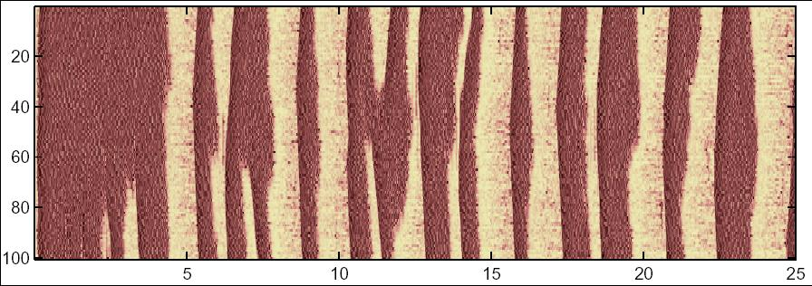

## README

for the model associated with:

Bazhenov M, Timofeev I, Steriade M, Sejnowski TJ (2002)
Model of thalamocortical slow-wave sleep oscillations and transitions to activated states.
*J Neurosci* **22**:8691-704

**This model is written in C++.** The following instructions have worked under Red Hat Linux 9 although the code should work with little or no modification on other platforms with ANSI compilers.

#### How to compile:

Change to the directory in which you have unzipped the archive file, then type:

```
g++ neur271.c rk.c -lm -O4 -ffast-math -o neur271
```

#### How to run:

```
./neur271 input27 > tmp &
```

The run (~7.5 hours on an 800 MHz Xeon Red Hat Linux PC) creates data files equivalent to figure 6 in the paper, e.g. one can find in the time_cx file 25 seconds of 100 pyramidal cell's activity:

<center>

</center>

Correspondence:
Dr. Maxim Bazhenov, The Salk Institute,
10010 North Torrey Pines Road, La Jolla, CA 92037.
E-mail: [bazhenov@salk.edu](mailto:bazhenov@salk.edu?Subject=thalamocortical%202002%20model)

---

2025-05-27 – Standardized to Markdown